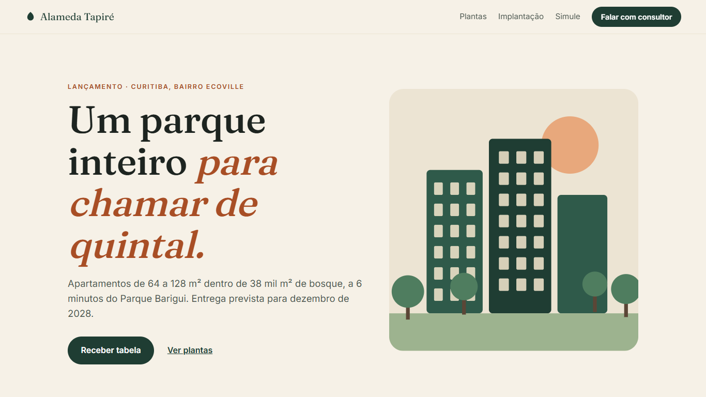
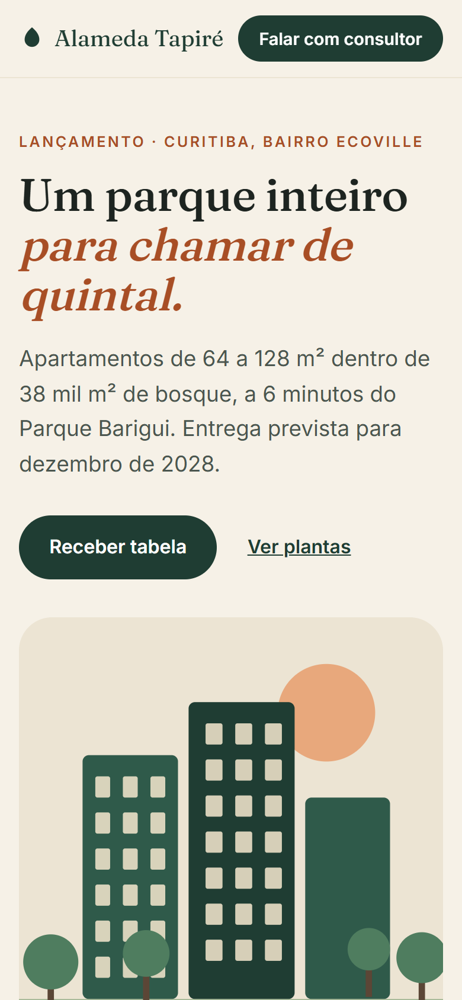

# Alameda Tapiré — real estate launch landing page

Demo landing page for a (fictional) residential condominium launch in Curitiba, Brazil. Portfolio project by Alisson Littig.

**Live demo:** https://alissonlittig.github.io/alameda-tapire/

> All names, prices, dates and figures are fictional and for demonstration only. The lead form sends nothing.




## Features
- Floor-plan tabs (2BR, 3BR, Garden) with schematic SVG plans
- Interactive site plan (hover / tap / keyboard) and construction progress
- Mortgage simulator (Price table) with unit-tested math
- FAQ, lead form, responsive from 390px, reduced-motion support, AA contrast

## Stack
Vite + React, self-hosted variable fonts (Fraunces, Inter), Vitest, GitHub Actions → GitHub Pages.

## Run
```
npm ci
npm test
npm run dev
npm run build
```
